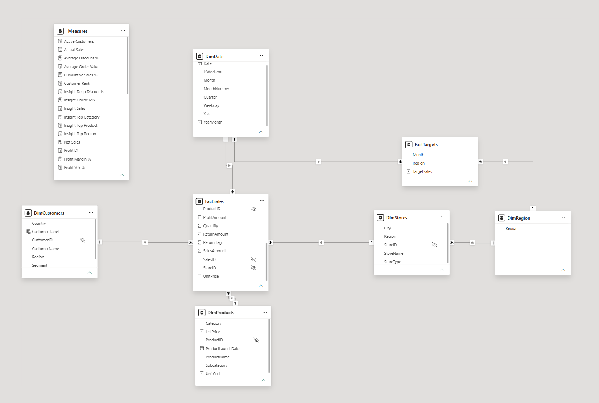
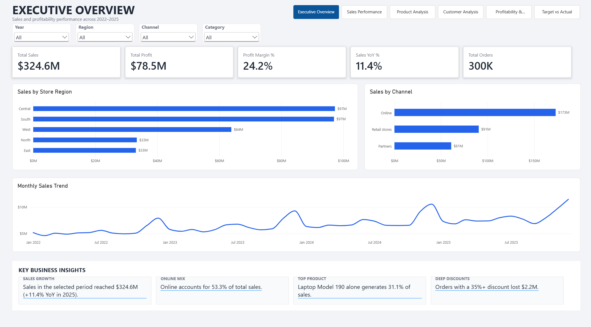
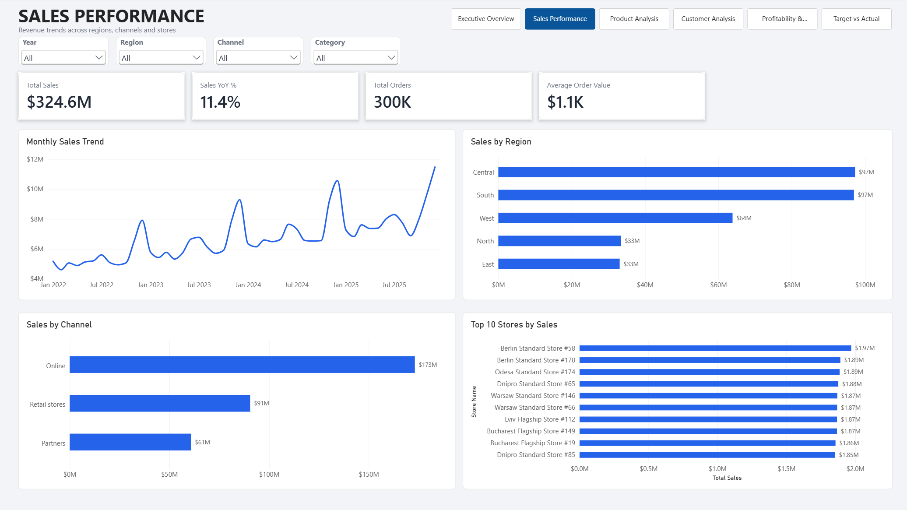
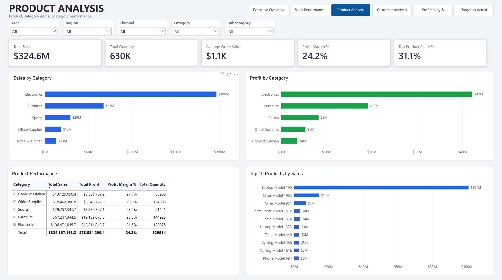
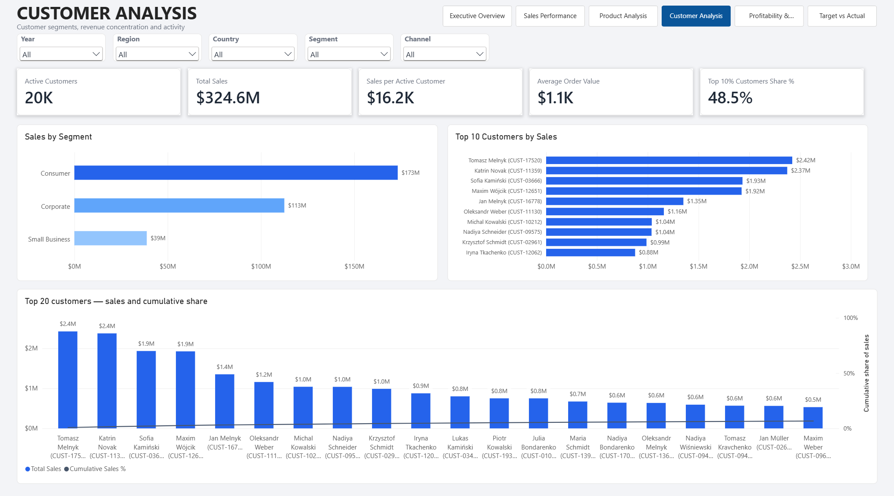
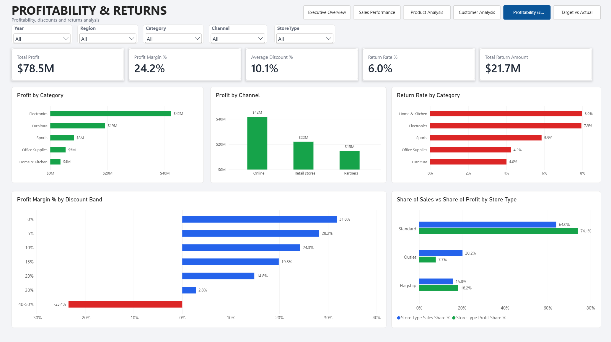
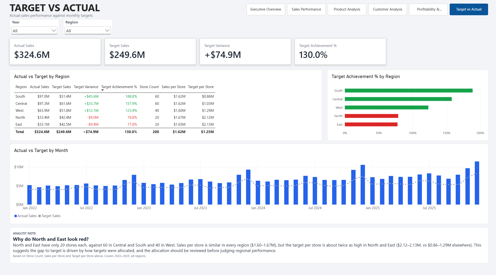

# Sales & Customer Performance Analytics

[](https://github.com/Vlad34745/Sales-Customer-Performance-PowerBI/actions/workflows/tests.yml)
[](https://codecov.io/gh/Vlad34745/Sales-Customer-Performance-PowerBI)
[](LICENSE)

An interactive Power BI portfolio project analyzing sales, customers, products, profitability, returns and target achievement for a fictional international retail and e-commerce business (2022–2025, 300,000 transactions).

> **Data note:** the dataset is synthetic, generated to simulate retail/e-commerce patterns. It is not real or confidential company data, and some patterns in it are artefacts of the generation process (see [Data caveats](Documentation/Business_Insights.md#data-caveats)).

## Key Findings

| # | Finding | Evidence |
|---|---|---|
| 1 | Growth is real but slowing | $65.2M (2022) → $96.4M (2025); YoY +17.1%, +13.4%, +11.4% |
| 2 | All net growth comes from Online | Online share 40.7% → 63.6%; Retail −6.9% and Partners −8.2% in 2025 |
| 3 | Growth comes from existing customers | New buyers 2,701 → 556 → 108; spend per customer +35% |
| 4 | One product = 31% of sales at half the margin | Laptop Model 190: 31.1% of sales, 14.4% margin vs 28.6% for the rest |
| 5 | Deep discounts destroy margin | 40–50% discount band: −23.4% margin, $2.2M loss; no lift in units per order |
| 6 | Deep discounting is an Outlet problem | Every 40–50% discount order is in an Outlet; Outlets: 25% average discount, 20.2% of sales but 7.7% of profit |
| 7 | North/East targets look disproportionately high | Sales per store is similar everywhere, but target per store is 2.1–2.5× higher in North/East, so target allocation deserves a review |
| 8 | Returns are concentrated in Electronics | 70.7% of the $21.7M refunded value |
| 9 | Moderate customer concentration | Top 10% of customers = 48.5% of sales; top 20 customers only 6.7% |
| 10 | Strong Q4 seasonality | November + December = 22.4% of annual sales |

Full narrative: [`Documentation/Business_Insights.md`](Documentation/Business_Insights.md). Prioritized actions with estimated impact: [`Documentation/Business_Recommendations.md`](Documentation/Business_Recommendations.md).

## Project Overview

The report is built to answer management questions such as:

- How are sales performing over time, and is growth sustainable?
- Which regions, channels and store formats drive revenue and profit?
- Which products and categories generate the most sales and profit, and how concentrated is revenue?
- Which customer segments and customers contribute the most?
- How do discounts and returns affect profitability?
- Are regions above or below target, and are the targets themselves fair?

## Dataset

| Table | Rows | Purpose |
|---|---:|---|
| FactSales | 300,000 | Transaction-level sales fact table |
| DimCustomers | 20,000 | Customer attributes |
| DimProducts | 2,000 | Product and pricing attributes |
| DimStores | 200 | Store attributes (Standard, Flagship, Outlet) |
| DimDate | 1,461 | Daily calendar for 2022–2025 |
| FactTargets | 240 | Monthly sales targets by region |

**Sales channels:** Online, Retail stores, Partners.
**Customer segments:** Consumer, Corporate, Small Business.
**Product categories:** Electronics, Office Supplies, Furniture, Home & Kitchen, Sports.
**Store types:** Standard, Flagship, Outlet.

## Data Model

The report uses a star schema: fact tables in the centre, descriptive dimension tables around them, all relationships one-to-many with single-direction filtering.

```text
DimCustomers[CustomerID]  1 ─── * FactSales[CustomerID]
DimProducts[ProductID]    1 ─── * FactSales[ProductID]
DimStores[StoreID]        1 ─── * FactSales[StoreID]
DimDate[Date]             1 ─── * FactSales[OrderDate]
DimRegion[Region]         1 ─── * DimStores[Region]
DimDate[Date]             1 ─── * FactTargets[Month]
DimRegion[Region]         1 ─── * FactTargets[Region]
```

All measures live in a dedicated `_Measures` table; technical key columns are hidden.



## Data Preparation

Power Query was used to prepare and validate the dataset, including:

- Data type validation
- Date field normalization
- Numeric field validation
- Key consistency checks
- Duplicate key checks
- Validation of foreign keys against dimension tables
- Preparation of the model for star-schema relationships

## DAX

The report uses DAX measures for revenue, cost, profit and margin, orders and quantity, average order value, discounts and discount bands, returns and net sales, year-over-year growth, target vs actual (including per-store targets), concentration (top product, top customers) and dynamic text insights.

Notable detail: year-over-year measures return a blank for multi-year selections and compare the latest selected year with the one before it, instead of shifting the whole date range back a year (which would produce a misleading growth figure when no year is selected).

See [`Documentation/DAX_Measures.md`](Documentation/DAX_Measures.md).

## Dashboard Pages

### 1. Executive Overview

Management summary: Total Sales, Total Profit, Profit Margin %, Sales YoY %, Total Orders; Monthly Sales Trend; Sales by Channel and Region; four dynamic insight cards (sales growth, Online mix, top-product dependency, deep-discount losses).



### 2. Sales Performance

Revenue trends and drivers: Total Sales, Sales YoY %, Total Orders, Average Order Value; Monthly Sales Trend; Sales by Region and Channel; Top 10 Stores.



### 3. Product Analysis

Product and category performance: Total Sales, Total Quantity, Average Order Value, Profit Margin %, Top Product Share %; Sales and Profit by Category; Top 10 Products; Product Performance matrix with drill-down to subcategory.



### 4. Customer Analysis

Customer activity and concentration: Active Customers, Total Sales, Sales per Active Customer, Average Order Value, Top 10% Customers Share %; Sales by Segment; Top 10 Customers; Top 20 customers with cumulative share.



### 5. Profitability & Returns

Profit drivers, discounts and returns: Total Profit, Profit Margin %, Average Discount %, Return Rate %, Total Return Amount; Profit by Category and Channel; Return Rate by Category; Profit Margin % by Discount Band; Share of Sales vs Share of Profit by Store Type.



### 6. Target vs Actual

Actual vs monthly regional targets: Actual Sales, Target Sales, Target Variance, Target Achievement %; Actual vs Target by Month and Region; per-store sales and target by region.



## Business Recommendations

In order of estimated impact (details and scenarios in the recommendations document):

1. Fix the Outlet pricing model (about +$7.1M profit if margin rose from 9% to 20%).
2. Cap deep discounts of 35% and above (the loss-making orders lost $2.2M).
3. Reduce dependence on Laptop Model 190 (each +1 pp of margin is worth about $1.0M).
4. Review regional target allocation (store count and history) before judging North/East performance.
5. Investigate Electronics returns and add Net Sales as a headline metric.
6. Plan for Online growth slowing while Retail and Partners decline.
7. Retain high-value accounts and restart new-customer acquisition.
8. Plan inventory and staffing around the November–December peak.

## Data Validation and Tests

The CSV files behind the report are checked by a small Python module, [`scripts/validate_data.py`](scripts/validate_data.py), covered by automated tests:

- primary keys are unique and non-empty, and every sales row points to an existing customer, product, store and date;
- `SalesAmount`, `CostAmount`, `ProfitAmount` and `ReturnAmount` follow their formulas;
- the calendar is continuous and covers all sales and targets;
- the headline numbers quoted in this README and in the documentation (total sales, profit, YoY, net sales, concentration and discount figures) are recomputed from the raw data, so they can be verified outside Power BI.

Run locally from the repository root:

```bash
pip install -r requirements-dev.txt
python -m pytest --cov=scripts
python -m scripts.validate_data
```

GitHub Actions runs the same tests on every push and reports coverage to Codecov. The coverage figure covers the validation module only; the Power BI report itself is not code that can be unit-tested.

## Tools

- Power BI Desktop
- Power Query
- DAX
- Data Modeling
- Excel / CSV
- Python (pandas, pytest) for data validation

## Project Structure

```text
Sales-Customer-Performance-PowerBI/
│
├── README.md
├── LICENSE
├── Sales_Customer_Performance_Analytics.pbix
├── requirements-dev.txt
│
├── Screenshots/
│   ├── 01_Executive_Overview.png
│   ├── 02_Sales_Performance.png
│   ├── 03_Product_Analysis.png
│   ├── 04_Customer_Analysis.png
│   ├── 05_Profitability_Returns.png
│   └── 06_Target_vs_Actual.png
│
├── Documentation/
│   ├── Business_Insights.md
│   ├── Business_Recommendations.md
│   ├── Data_Dictionary.md
│   ├── DAX_Measures.md
│   ├── Data_Model.png
│   └── Project_Summary.md
│
├── Data/
│   ├── DimCustomers.csv
│   ├── DimDate.csv
│   ├── DimProducts.csv
│   ├── DimStores.csv
│   ├── FactSales.csv
│   └── FactTargets.csv
│
├── scripts/
│   └── validate_data.py
│
├── tests/
│   └── test_validate_data.py
│
└── .github/workflows/
    └── tests.yml
```

## License

Released under the [MIT License](LICENSE). The dataset is synthetic and is included under the same license.
# Sales-Customer-Performance-PowerBI

